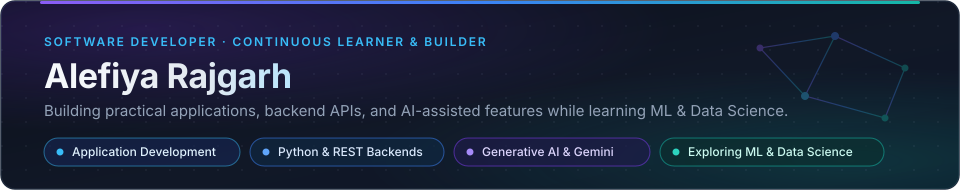

  

   

  

    &nbsp;
    &nbsp;
    
  

## About Me

- **Software Developer**, working on real-world software products and applications.
- Pursuing an integrated **B.Tech + M.Tech in Artificial Intelligence & Data Science**, with a strong technical foundation across Machine Learning, Agentic AI, and Explainable AI (XAI).
- Interested in building scalable applications, connecting backend systems, and solving practical problems through technology.
- Exploring **Artificial Intelligence, Generative AI, and Machine Learning**.
- Working with **Python, Flutter, APIs, databases, and cloud technologies**.
- Always learning, experimenting with new technologies, and turning ideas into practical solutions.

## Tech Stack

### Programming Languages

  

`Python` · `Dart` · `Java` · `C` · `C++` · `R` · `SQL` · `NoSQL`

### Software & Application Development

  

`Flutter` · `Flame` · `Firebase` · `REST API Integration` · `Git` · `GitHub`

### AI, Machine Learning & Data Science

  &nbsp;
  &nbsp;
  &nbsp;
  

`Generative AI` · `Gemini API` · `Python` · `Machine Learning` · `Data Analysis` · `NumPy` · `Pandas` · `Agentic AI` · `Explainable AI`

### Cloud, Backend & Databases

  

`AWS` · `DynamoDB` · `FastAPI` · `Node.js` · `SQLite`

### Development & Analytics Tools

  &nbsp;
  &nbsp;
  

`VS Code` · `Android Studio` · `GitHub Desktop` · `Figma` · `Stitch` · `Canva` · `Power BI` · `Advanced Excel`

## Projects

| Project | Summary | Tech Stack |
| :--- | :--- | :--- |
| **Soulene** | Mental wellness platform featuring assessments, mood tracking, wellness activities, and AI chat | `Flutter` · `Dart` · `Firebase` · `AWS` · `DynamoDB` · `REST APIs` |
| **Soulene Mentor** | Mentor management app to oversee assigned users, schedule sessions, and manage wellness groups | `Flutter` · `Dart` · `Clean Architecture` · `Riverpod` · `REST APIs` |
| **Soulene AI** | Conversational wellness assistant providing supportive dialogue and safety boundary guardrails | `Python` · `FastAPI` · `Gemini API` · `REST APIs` · `Pydantic` |
| **DocNest** | Document & receipt scanner with PDF creation, due date reminders, and AI-assisted text extraction | `Flutter` · `Dart` · `Gemini API` · `PDF` · `Local Storage` |
| **Arrow Land** | 2D grid puzzle game featuring directional arrow mechanics, level progression, and game logic | `Flutter` · `Dart` · `Flame` · `Firebase` · `AdMob` |
| **[Expense Tracker](https://github.com/Alefiya-Rajgarh/Expense-Tracker-app)** | Personal finance tracker with category insights, monthly budget carry-forward, and analytics charts | `Flutter` · `Dart` · `Firebase` · `Hive` · `fl_chart` |
| **[Soybean Gyan](https://github.com/Alefiya-Rajgarh/Soybean_Gyan)** | Agricultural decision-support app for farmers with crop management, weather insights, and market data | `Flutter` · `Dart` · `REST APIs` · `Weather APIs` |
| **[Chatbot](https://github.com/Alefiya-Rajgarh/Chatbot)** | Interactive conversational assistant with real-time responses and messaging interface | `Flutter` · `Dart` · `REST APIs` · `Chat UI` |

## GitHub Stats

  
  
   
  

  <a href="https://www.linkedin.com/in/alefiya-rajgarh-72b5ab28b/">LinkedIn</a> · <a href="mailto:alefiyarajgarh@gmail.com">alefiyarajgarh@gmail.com</a>

